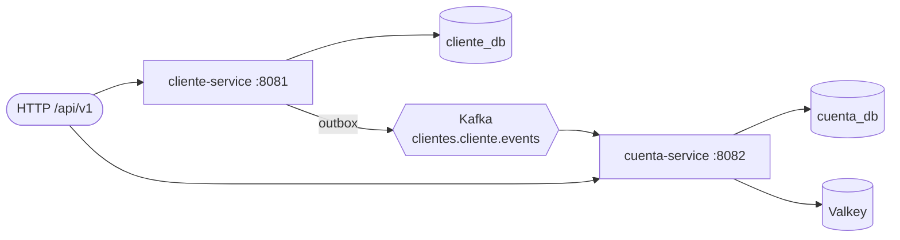
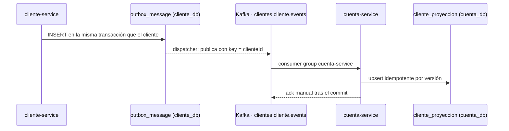

# devsu-bank

Prueba técnica Devsu (Java): dos microservicios bancarios — **clientes** y **cuentas/movimientos** —
comunicados de forma asíncrona, desplegables con Docker.

**Repositorio:** https://github.com/andresmontoyat/devsu · **Versión:** 2.0.0 (API v1) ·
[CHANGELOG](CHANGELOG.md)

**Stack:** Java 21 · Spring Boot 4.1 · JPA (Hibernate 7) · PostgreSQL 17 · Liquibase · Kafka 4 (KRaft) ·
Valkey 9 · OpenAPI 3 (openapi-generator + springdoc) · Micrometer + OpenTelemetry · Testcontainers · Karate ·
ArchUnit · Gradle 9.

### Inicio rápido

```bash
git clone https://github.com/andresmontoyat/devsu.git && cd devsu
docker compose -f docker/docker-compose.yaml up -d --build --wait
curl -s http://localhost:8081/api/v1/clientes
```

| | cliente-service | cuenta-service |
|-|-----------------|----------------|
| API v1 | http://localhost:8081/api/v1/clientes | http://localhost:8082/api/v1/cuentas · `/movimientos` · `/reportes` |
| Swagger UI | http://localhost:8081/api/swagger-ui.html | http://localhost:8082/api/swagger-ui.html |
| Contrato OpenAPI | http://localhost:8081/api/v3/api-docs | http://localhost:8082/api/v3/api-docs |

Postman: importar [`postman/`](postman) y ejecutar la carpeta *0. Casos de uso del enunciado*.



**Contenido:** [Despliegue con Docker](#despliegue-con-docker) ·
[Cómo probar la aplicación](#cómo-probar-la-aplicación) · [API](#api) ·
[Mensajería asíncrona](#mensajería-asíncrona) · [Entregables](#entregables) ·
[Funcionalidades](#funcionalidades) · [Pruebas](#pruebas) · [Comandos](#comandos) · [Estructura](#estructura) ·
[Patrones aplicados](#patrones-aplicados) · [Decisiones principales](#decisiones-principales)

El diseño completo — capas hexagonales, outbox, consumo idempotente, registro de movimientos, modelo de
datos y cómo se cubren rendimiento, escalabilidad y resiliencia — está en
**[docs/arquitectura.md](docs/arquitectura.md)**.

## Despliegue con Docker

### Requisitos

| Requisito | Detalle |
|-----------|---------|
| Docker | Docker Engine 24+ o Docker Desktop, con Compose v2 (`docker compose version`) |
| Memoria | ~3 GB libres para Docker (el stack usa ~2 GB) |
| Puertos libres | 8081, 8082, 3000, 5432, 9092 y 6379 (se pueden cambiar, ver [Configuración](#configuración)) |
| Red | Solo la primera vez: descarga imágenes base y dependencias de Gradle |

No hace falta Java: las imágenes se compilan dentro de Docker. Funciona en Linux, macOS (Intel y Apple
Silicon) y Windows con WSL 2.

### 1. Obtener el código

```bash
git clone https://github.com/andresmontoyat/devsu.git
cd devsu
```

O descomprimir el `.zip` de la entrega y entrar en la carpeta `devsu-bank/`. Todos los comandos se ejecutan
desde la raíz del proyecto.

### 2. (Opcional) Configurar

Sin configuración usa los valores por defecto. Para cambiar puertos o contraseñas:

```bash
cp docker/.env.example docker/.env   # y editar los valores
```

### 3. Levantar

```bash
docker compose -f docker/docker-compose.yaml up -d --build --wait
```

Compila las imágenes de los dos servicios (la primera vez tarda unos minutos), arranca la infraestructura en
orden y termina cuando todo está sano. El orden lo garantizan los `healthcheck` y `depends_on`:

1. `postgres` crea `cliente_db` y `cuenta_db` con sus roles; `kafka`, `valkey` y `otel-lgtm` arrancan en paralelo.
2. `kafka-init` espera a Kafka, crea los topics y termina.
3. `cliente-service` arranca cuando PostgreSQL está sano y los topics existen; `cuenta-service`, además,
   cuando Valkey está sano.

### 4. Verificar

```bash
docker compose -f docker/docker-compose.yaml ps -a
```

Todos los servicios deben estar `Up (healthy)`, salvo `kafka-init`, que debe quedar `Exited (0)`. Prueba rápida:

```bash
curl -s http://localhost:8081/api/v1/clientes; echo
curl -s http://localhost:8082/api/v1/cuentas/478758; echo
```

La primera devuelve los tres clientes de ejemplo y la segunda la cuenta 478758 de Jose Lema. La API también
se puede explorar y probar desde Swagger UI: http://localhost:8081/api/swagger-ui.html y
http://localhost:8082/api/swagger-ui.html.

### Servicios y puertos

| Servicio | URL / host en tu máquina | Credenciales |
|----------|--------------------------|--------------|
| cliente-service | http://localhost:8081/api/v1/clientes | — |
| cuenta-service | http://localhost:8082/api/v1/cuentas · `/api/v1/movimientos` · `/api/v1/reportes` | — |
| Swagger UI | http://localhost:8081/api/swagger-ui.html · http://localhost:8082/api/swagger-ui.html | — |
| Contrato OpenAPI | http://localhost:8081/api/v3/api-docs · http://localhost:8082/api/v3/api-docs | — |
| Grafana (trazas en Tempo, métricas en Prometheus) | http://localhost:3000 | acceso anónimo |
| PostgreSQL | `localhost:5432` — bases `cliente_db` y `cuenta_db` | `cliente_app` / `cliente_app`, `cuenta_app` / `cuenta_app` (solo DML) |
| Kafka | `localhost:9092` — topic `clientes.cliente.events` (+ `.dlt`) | — |
| Valkey | `localhost:6379` | — |

El actuator de cada servicio (`9081`, `9082`) no se publica fuera de la red de compose. Consultar las bases sin
cliente instalado:

```bash
docker compose -f docker/docker-compose.yaml exec postgres psql -U cliente_app -d cliente_db -c 'select * from cliente'
docker compose -f docker/docker-compose.yaml exec postgres psql -U cuenta_app -d cuenta_db -c 'select * from cuenta'
```

### Datos de ejemplo

Al arrancar, cada servicio aplica sus migraciones de Liquibase y carga los **datos del enunciado** (contexto
`demo`): los clientes Jose Lema, Marianela Montalvo y Juan Osorio y las cuentas del caso 2 (478758, 225487,
495878 y 496825). Los casos 3 a 5 se ejecutan por la API: ver
[Cómo probar la aplicación](#cómo-probar-la-aplicación). `LIQUIBASE_CONTEXTS=` vacío en `docker/.env`
arranca sin datos.

### Operación

| Acción | Comando |
|--------|---------|
| Ver logs | `docker compose -f docker/docker-compose.yaml logs -f cliente-service cuenta-service` |
| Parar conservando los datos | `docker compose -f docker/docker-compose.yaml down` |
| Parar y borrar los datos (volver a la seed) | `docker compose -f docker/docker-compose.yaml down -v` |
| Recompilar un servicio tras cambiar código | `docker compose -f docker/docker-compose.yaml up -d --build --wait cuenta-service` |
| Reiniciar un servicio | `docker compose -f docker/docker-compose.yaml restart cliente-service` |

### Configuración

Variables de `docker/.env` (todas opcionales; el valor por defecto se aplica si no están):

| Variable | Defecto | Uso |
|----------|---------|-----|
| `CLIENTE_SERVICE_PORT` / `CUENTA_SERVICE_PORT` | `8081` / `8082` | Puertos publicados de las APIs |
| `POSTGRES_PORT` · `KAFKA_PORT` · `VALKEY_PORT` · `GRAFANA_PORT` | `5432` · `9092` · `6379` · `3000` | Puertos publicados de la infraestructura |
| `POSTGRES_PASSWORD` | `postgres` | Superusuario de PostgreSQL |
| `CLIENTE_DB_OWNER_PASSWORD` · `CLIENTE_DB_APP_PASSWORD` | `cliente_owner` · `cliente_app` | Rol de migraciones y rol de la aplicación de `cliente_db` |
| `CUENTA_DB_OWNER_PASSWORD` · `CUENTA_DB_APP_PASSWORD` | `cuenta_owner` · `cuenta_app` | Ídem para `cuenta_db` |
| `LIQUIBASE_CONTEXTS` | `demo` | `demo` carga los datos de ejemplo; vacío, no |
| `LOGGING_STRUCTURED_FORMAT_CONSOLE` | vacío | `logstash` o `ecs` para logs en JSON |

Las contraseñas de PostgreSQL se aplican **solo al crear el volumen**: tras cambiarlas, recrear con `down -v`.
Si se cambian los puertos de las APIs, ajustar también `cuentaUrl` / `clienteUrl` en el entorno de Postman y
`E2E_CLIENTE_URL` / `E2E_CUENTA_URL` para `./gradlew e2eTest`.

### Problemas frecuentes

| Síntoma | Causa y solución |
|---------|------------------|
| `Bind for 0.0.0.0:5432 failed: port is already allocated` | Otro proceso usa el puerto: cambiarlo en `docker/.env` (p. ej. `POSTGRES_PORT=15432`) |
| `--wait` falla o un servicio queda `unhealthy` | `docker compose -f docker/docker-compose.yaml logs <servicio>`; suele ser memoria insuficiente para Docker |
| La compilación falla descargando Gradle o dependencias | Red intermitente en la primera compilación: repetir el `up --build` |
| `422 CLIENTE_NO_DISPONIBLE` al abrir una cuenta de un cliente recién creado | El evento aún viaja por Kafka (milisegundos): reintentar |
| Los casos 3 a 5 responden `409` o `422` | Ya se ejecutaron sobre este stack: `down -v` y volver a levantar |

## Cómo probar la aplicación

Con el stack levantado (sección anterior) hay tres formas de probar, de la más manual a la más automática.

### 1. Paso a paso con curl

Los bloques se pueden copiar en orden en una terminal. Los casos 3 a 5 modifican saldos: se ejecutan **una vez**
sobre un stack recién levantado (`docker compose -f docker/docker-compose.yaml down -v` lo reinicia). Agregar
`| jq` al final de cada comando formatea el JSON, si está instalado.

```bash
CLIENTES=http://localhost:8081/api/v1
CUENTAS=http://localhost:8082/api/v1
JOSE=0b6f5c9e-1d2a-4c3b-8e7f-1a2b3c4d5e01        # ids fijos de los clientes de ejemplo
MARIANELA=0b6f5c9e-1d2a-4c3b-8e7f-1a2b3c4d5e02
HOY=$(TZ=America/Guayaquil date +%F)              # el reporte usa el día de Ecuador
```

**Caso 1 — clientes** (cargados por la seed) y alta de uno nuevo:

```bash
curl -s "$CLIENTES/clientes?page=0&size=10"; echo

curl -si -X POST "$CLIENTES/clientes" -H 'Content-Type: application/json' -d '{
  "nombre": "Ana Torres", "genero": "FEMENINO", "edad": 28, "identificacion": "1799999999",
  "direccion": "Av. Shyris", "telefono": "0991234567", "contrasena": "9876", "estado": true}'; echo
```

La respuesta es `201` con un header `Location` que apunta a `/api/v1/clientes/{clienteId}` y nunca incluye la contraseña.

**Caso 2 — cuentas de Marianela Montalvo** (seed):

```bash
curl -s "$CUENTAS/cuentas?cliente=$MARIANELA"; echo
```

**Caso 3 — nueva cuenta corriente 585545 para Jose Lema:**

```bash
curl -s -X POST "$CUENTAS/cuentas" -H 'Content-Type: application/json' \
  -d "{\"numeroCuenta\": \"585545\", \"tipoCuenta\": \"Corriente\", \"saldoInicial\": 1000, \"estado\": true, \"clienteId\": \"$JOSE\"}"; echo
```

**Caso 4 — movimientos** (F2: el signo define depósito o retiro y el saldo se actualiza):

```bash
for mov in '478758 -575' '225487 600' '495878 150' '496825 -540'; do
  set -- $mov
  curl -s -X POST "$CUENTAS/movimientos" -H 'Content-Type: application/json' \
    -d "{\"numeroCuenta\": \"$1\", \"valor\": $2}"; echo
done
```

**F3 — retiro sin saldo** (la cuenta 496825 quedó en 0):

```bash
curl -si -X POST "$CUENTAS/movimientos" -H 'Content-Type: application/json' \
  -d '{"numeroCuenta": "496825", "valor": -100}'; echo
```

Responde `422` con `"detail": "Saldo no disponible"` y el saldo no cambia.

**Caso 5 — estado de cuenta de Marianela Montalvo** (F4):

```bash
curl -s "$CUENTAS/reportes?fechaInicio=$HOY&fechaFin=$HOY&cliente=$MARIANELA"; echo
```

Devuelve las filas `225487 · Corriente · 100 → 600 → 700` y `496825 · Ahorros · 540 → -540 → 0`, como en el
ejemplo del enunciado (ver [API](#api)).

**Reintento seguro con `Idempotency-Key`:** el segundo envío devuelve el mismo movimiento, sin volver a sumarlo.

```bash
for intento in 1 2; do
  curl -s -X POST "$CUENTAS/movimientos" -H 'Content-Type: application/json' \
    -H 'Idempotency-Key: demo-deposito-1' -d '{"numeroCuenta": "495878", "valor": 10}'; echo
done
```

**Comunicación asíncrona:** un cliente creado en cliente-service llega a cuenta-service por Kafka y desde ese
momento se le pueden abrir cuentas.

```bash
ID=$(curl -s -X POST "$CLIENTES/clientes" -H 'Content-Type: application/json' -d '{
  "nombre": "Luis Paz", "genero": "MASCULINO", "edad": 45, "identificacion": "1788888888",
  "direccion": "Av. Amazonas", "telefono": "0998887777", "contrasena": "4321", "estado": true}' \
  | sed -E 's/.*"clienteId":"([^"]+)".*/\1/')
sleep 1
curl -s -X POST "$CUENTAS/cuentas" -H 'Content-Type: application/json' \
  -d "{\"numeroCuenta\": \"700000001\", \"tipoCuenta\": \"Ahorros\", \"saldoInicial\": 50, \"clienteId\": \"$ID\"}"; echo
```

### 2. Colección Postman

Importar `postman/devsu-bank.postman_collection.json` y `postman/devsu-bank.postman_environment.json`, elegir el
entorno *devsu-bank local* y ejecutar la colección con el *Collection Runner*. La carpeta **0. Casos de uso del
enunciado** reproduce los casos 1–5 (sobre un stack recién levantado) y las carpetas 1–4 prueban cada recurso.
Cada petición tiene sus aserciones. Sin Postman instalado:

```bash
npx newman run postman/devsu-bank.postman_collection.json -e postman/devsu-bank.postman_environment.json
```

### 3. Suite automática contra el stack

```bash
./gradlew e2eTest
```

Ejecuta con Karate los casos 1–5 y la propagación asíncrona de cambios y bajas de clientes. Crea sus propios
datos, así que se puede repetir sin reiniciar el stack. Si se cambiaron los puertos:
`E2E_CLIENTE_URL=http://localhost:18081/api/v1 E2E_CUENTA_URL=http://localhost:18082/api/v1 ./gradlew e2eTest`.

### 4. Swagger UI

Cada servicio publica su contrato OpenAPI con Swagger UI: http://localhost:8081/api/swagger-ui.html
(clientes) y http://localhost:8082/api/swagger-ui.html (cuentas, movimientos y reportes). Cada operación
muestra sus ejemplos y todos sus errores, y se puede ejecutar con *Try it out*.

### Observabilidad

Grafana en http://localhost:3000 → *Explore* → **Tempo** muestra cada petición como una traza que cruza ambos
servicios a través de Kafka; el `traceId` es el mismo que devuelven los errores `problem+json`. Las métricas
`usecase_operation_*` y `http_server_requests_*` están en **Prometheus**. El actuator no se publica fuera de la
red de compose:

```bash
docker compose -f docker/docker-compose.yaml exec cuenta-service wget -qO- http://127.0.0.1:9082/actuator/health; echo
```

## API

La API se define **primero en OpenAPI** y el código se genera desde ese contrato
([ADR-0015](docs/adr/0015-contrato-openapi-primero.md)):
[`cliente-service.yaml`](cliente-service/infrastructure/entry-points/rest-controller/src/main/resources/openapi/cliente-service.yaml)
y
[`cuenta-service.yaml`](cuenta-service/infrastructure/entry-points/rest-controller/src/main/resources/openapi/cuenta-service.yaml).
Con el stack levantado se navega en Swagger UI (`/api/swagger-ui.html`) y se descarga en `/api/v3/api-docs`.

Contrato: `http://{servidor}:{puerto}/api/v1/{recurso}`: la versión mayor va en la ruta
([ADR-0017](docs/adr/0017-versionado-de-la-api-en-la-ruta.md)); un cambio incompatible publica `/api/v2` junto a
`/api/v1`. Errores en formato
[RFC 9457](https://www.rfc-editor.org/rfc/rfc9457) (`application/problem+json`) con `code` estable y `traceId`.

| Método | Ruta | Descripción |
|--------|------|-------------|
| `POST` `GET` | `/clientes` | Crear · listar (`?page=&size=`) |
| `GET` `PUT` `PATCH` `DELETE` | `/clientes/{clienteId}` | Obtener · reemplazar · modificar (`application/merge-patch+json`) · eliminar |
| `POST` `GET` | `/cuentas` | Crear · listar (`?cliente=`) |
| `GET` `PUT` `PATCH` | `/cuentas/{numeroCuenta}` | Obtener · reemplazar · modificar |
| `POST` `GET` | `/movimientos` | Registrar (header opcional `Idempotency-Key`) · listar (`?cuenta=&fechaInicio=&fechaFin=`) |
| `GET` `PUT` | `/movimientos/{movimientoId}` | Obtener · corregir el último movimiento de la cuenta |
| `GET` | `/reportes?fechaInicio={yyyy-MM-dd}&fechaFin={yyyy-MM-dd}&cliente={clienteId}` | Estado de cuenta (F4); las dos fechas son obligatorias |

Cuentas y movimientos no se eliminan (CRU, como pide el enunciado): una cuenta se desactiva con
`PATCH {"estado": false}` y un movimiento erróneo se corrige, de modo que el historial sigue siendo auditable.

**Movimiento sin saldo (F3):**

```http
POST /api/v1/movimientos
{"numeroCuenta": "496825", "valor": -100}

HTTP/1.1 422
{"type": "https://api.devsu-bank.example/errores/saldo-no-disponible", "title": "Saldo no disponible",
 "status": 422, "detail": "Saldo no disponible", "code": "SALDO_NO_DISPONIBLE", "traceId": "..."}
```

**Estado de cuenta (F4)** — `GET /api/v1/reportes?fechaInicio=2026-10-29&fechaFin=2026-10-29&cliente=0b6f5c9e-1d2a-4c3b-8e7f-1a2b3c4d5e02`.
Cada fila de `movimientos` usa las claves del JSON de ejemplo; `cuentas` añade los saldos y totales del rango:

```json
{
  "cliente": { "clienteId": "0b6f5c9e-1d2a-4c3b-8e7f-1a2b3c4d5e02", "nombre": "Marianela Montalvo" },
  "fechaInicio": "2026-10-29",
  "fechaFin": "2026-10-29",
  "cuentas": [
    { "numeroCuenta": "225487", "tipoCuenta": "CORRIENTE", "saldoInicial": 100.0, "saldoDisponible": 700.0,
      "estado": true, "totalCreditos": 600.0, "totalDebitos": 0.0 },
    { "numeroCuenta": "496825", "tipoCuenta": "AHORROS", "saldoInicial": 540.0, "saldoDisponible": 0.0,
      "estado": true, "totalCreditos": 0.0, "totalDebitos": 540.0 }
  ],
  "movimientos": [
    { "Fecha": "29/10/2026", "Cliente": "Marianela Montalvo", "Numero Cuenta": "225487", "Tipo": "Corriente",
      "Saldo Inicial": 100.0, "Estado": true, "Movimiento": 600.0, "Saldo Disponible": 700.0 },
    { "Fecha": "29/10/2026", "Cliente": "Marianela Montalvo", "Numero Cuenta": "496825", "Tipo": "Ahorros",
      "Saldo Inicial": 540.0, "Estado": true, "Movimiento": -540.0, "Saldo Disponible": 0.0 }
  ]
}
```

"Saldo Inicial" de cada fila es el saldo de la cuenta justo antes de ese movimiento.

## Mensajería asíncrona

cliente-service publica un evento por cada alta, cambio o baja de un cliente; cuenta-service lo consume para
mantener su proyección local de clientes (`cliente_proyeccion`). Es la única comunicación entre los servicios.



### Topics

| Topic | Particiones | Clave | Productor | Consumidor | Contenido |
|-------|------------|-------|-----------|------------|-----------|
| `clientes.cliente.events` | 3 | `clienteId` | cliente-service (outbox) | cuenta-service, grupo `cuenta-service` | `ClienteCreado`, `ClienteActualizado`, `ClienteEliminado` |
| `clientes.cliente.events.dlt` | 3 | la del mensaje original | cuenta-service (error handler) | ninguno: inspección manual | Mensajes que no se pudieron procesar |

- **Creación:** los crea el job `kafka-init` de docker compose; los servicios nunca crean topics
  (`auto.create.topics.enable=false`). Factor de replicación 1 en local.
- **Orden:** la clave `clienteId` envía todos los eventos de un cliente a la misma partición, así se aplican
  en orden. Las 3 particiones permiten hasta 3 instancias de cuenta-service en paralelo.
- **Retención:** la del broker por defecto (7 días). Un consumidor nuevo lee desde el principio
  (`auto-offset-reset: earliest`) y reconstruye la proyección con lo que siga retenido; en producción se usaría
  `cleanup.policy=compact` para conservar siempre el último evento de cada cliente.
- **DLT:** recibe los mensajes inválidos y los rechazos de negocio sin reintentar, y los errores transitorios
  después de 3 reintentos (1 s, 2 s, 4 s). Conserva la partición del original y Spring agrega los headers
  `kafka_dlt-exception-*` con la causa.

### Contrato del mensaje

**Headers**

| Header | Ejemplo | Uso |
|--------|---------|-----|
| `outbox-message-id` | `52df04ac-cb56-479b-b417-e79c56f81e15` | Id único del mensaje (UUID). El consumidor lo usa para descartar duplicados; sin él, el mensaje va a la DLT |
| `traceparent` | `00-e1555e74b1022568f87c2eccf8ac4a4b-96595679be1c7504-01` | W3C Trace Context: la traza sigue de cliente-service a cuenta-service |
| `content-type` | `application/json` | Formato del valor |

**Valor** — un sobre (`EventMessage`) con `header` de metadatos y `body` con el evento. Mensaje real de
`ClienteCreado`:

```json
{
  "header": {
    "traceId": "e1555e74b1022568f87c2eccf8ac4a4b",
    "version": "1.0.0",
    "schemaVersion": "1.0.0",
    "origin": "cliente-service",
    "timestamp": "2026-10-29T20:03:18.253001974Z",
    "locale": null
  },
  "body": {
    "aggregate": "84e44901-f46d-4474-bea2-8fae9985328d",
    "eventName": "ClienteCreado",
    "eventType": "EVENT",
    "payload": {
      "clienteId": "84e44901-f46d-4474-bea2-8fae9985328d",
      "nombre": "Juan Osorio",
      "estado": true,
      "version": 0
    }
  }
}
```

| Campo | Significado |
|-------|-------------|
| `header.version` | Versión del sobre (`1.0.0`) |
| `header.schemaVersion` | Versión del `payload`; cambia solo ante un cambio incompatible |
| `header.origin` | Servicio que publicó el evento |
| `header.timestamp` | Momento en que se registró el evento (UTC) |
| `header.traceId` | Traza de la petición que originó el evento |
| `body.aggregate` | Id del agregado (`clienteId`), igual a la clave del mensaje |
| `body.eventName` | Tipo de evento (tabla siguiente) |

**Eventos**

| `eventName` | Cuándo | `payload` | Efecto en cuenta-service |
|-------------|--------|-----------|--------------------------|
| `ClienteCreado` | `POST /clientes` | `{clienteId, nombre, estado, version}` | Crea el cliente en la proyección: ya se le pueden abrir cuentas |
| `ClienteActualizado` | `PUT` o `PATCH /clientes/{id}` | `{clienteId, nombre, estado, version}` | Actualiza nombre y estado; con `estado: false` no se le abren cuentas nuevas |
| `ClienteEliminado` | `DELETE /clientes/{id}` | `{clienteId, version}` | Marca el cliente como eliminado (*tombstone*): no se le abren cuentas y su historial se conserva para reportes |

`version` crece en cada cambio del cliente. cuenta-service aplica un evento solo si su versión es mayor que la
que ya tiene, así que los duplicados y los eventos atrasados no tienen efecto.

**Compatibilidad.** El consumidor es un *tolerant reader*: lee solo `eventName`, `clienteId`, `nombre`,
`estado` y `version`, ignora campos nuevos e ignora (con *ack*) los `eventName` que no conoce. El productor puede
agregar campos sin coordinar despliegues; un cambio incompatible sube `schemaVersion`.

**Ver los mensajes** con el stack levantado:

```bash
docker compose -f docker/docker-compose.yaml exec kafka /opt/kafka/bin/kafka-console-consumer.sh \
  --bootstrap-server kafka:19092 --topic clientes.cliente.events --from-beginning \
  --formatter-property print.key=true --formatter-property print.headers=true --timeout-ms 5000
```

## Entregables

| Entregable | Dónde |
|------------|-------|
| Script de base de datos | [`BaseDatos.sql`](BaseDatos.sql) — esquema y datos de ejemplo de ambas bases. Se **genera** desde los changelogs de Liquibase (`./gradlew generateBaseDatos`) y `BaseDatosSqlIT` falla si se desalinea. Carga manual: `psql -U postgres -f BaseDatos.sql` |
| Contrato OpenAPI y Swagger UI | `*/infrastructure/entry-points/rest-controller/src/main/resources/openapi/*.yaml`; publicado en `/api/v3/api-docs` y `/api/swagger-ui.html` |
| Colección Postman | [`postman/devsu-bank.postman_collection.json`](postman/devsu-bank.postman_collection.json) + [entorno](postman/devsu-bank.postman_environment.json) (`clienteUrl` y `cuentaUrl` apuntan a `/api/v1`) |
| Registro de cambios y decisiones | [`CHANGELOG.md`](CHANGELOG.md) · [`docs/adr/`](docs/adr/README.md) (17 ADRs) · [`docs/arquitectura.md`](docs/arquitectura.md) |
| Pruebas Karate | `*/bootstrap/src/test/resources/karate/**` — corren con todos los tests en `./gradlew build` |
| Despliegue en contenedores | `cliente-service/Dockerfile`, `cuenta-service/Dockerfile`, [`docker/docker-compose.yaml`](docker/docker-compose.yaml) |

### Colección Postman

Importar la colección y el entorno en Postman (v9.13+) y ejecutar la carpeta **0. Casos de uso del
enunciado** sobre un stack recién levantado: consulta los datos de los casos 1 y 2, crea la cuenta 585545,
registra los cuatro movimientos, comprueba "Saldo no disponible" y pide el estado de cuenta de Marianela.
Las carpetas 1 a 4 recorren el CRUD de cada recurso con datos propios y se pueden repetir. Las URLs
usan `/api/v1` y el rango de fechas va en `fechaInicio` y `fechaFin`. Si cambiaste los puertos, ajustar
`clienteUrl` / `cuentaUrl` en el entorno.

Con Newman:

```bash
npx newman run postman/devsu-bank.postman_collection.json -e postman/devsu-bank.postman_environment.json
```

## Funcionalidades

| | Requisito | Implementación |
|-|-----------|----------------|
| F1 | CRUD clientes; CRU cuentas y movimientos | `ClienteController`, `CuentaController`, `MovimientoController`, que implementan las interfaces generadas del contrato OpenAPI |
| F2 | Movimientos positivos/negativos, saldo actualizado, registro de transacciones | `Cuenta.aplicarMovimiento`; cada `movimiento` guarda saldo anterior y resultante |
| F3 | "Saldo no disponible" | `SaldoNoDisponibleException` → `422` `SALDO_NO_DISPONIBLE` |
| F4 | Reporte por rango de fechas y cliente | `GET /api/v1/reportes?fechaInicio=&fechaFin=&cliente=` → `GenerateEstadoCuentaUseCase` |
| F5 | Prueba unitaria de la entidad Cliente | [`ClienteTest`](cliente-service/domain/src/test/java/com/devsu/bank/cliente/domain/model/ClienteTest.java) |
| F6 | Prueba de integración | `ClienteApiIT`, `MovimientoSaldoNoDisponibleIT`, `ClienteEventoIT`, ITs de adaptadores con Testcontainers |
| F7 | Despliegue en contenedores | Dockerfiles multi-stage + docker compose, con Swagger UI publicado |

## Pruebas

Requisitos: JDK 21 y Docker (Testcontainers levanta PostgreSQL, Kafka y Valkey reales).

```bash
./gradlew build      # unitarias, integración, ArchUnit, Karate, BaseDatos.sql y cobertura de ambos servicios
./gradlew e2eTest    # casos de uso 1-5 contra el stack de docker compose (debe estar levantado)
```

| Nivel | Herramienta | Qué cubre |
|-------|-------------|-----------|
| Dominio | JUnit 6 + AssertJ, sin mocks | Reglas de `Cliente`, `Cuenta`, `Movimiento`, value objects |
| Casos de uso | JUnit con *fakes* de los puertos | Orquestación, transacción, outbox, idempotencia |
| Adaptadores | Testcontainers (PostgreSQL, Kafka, Valkey) | JPA y Liquibase, outbox, consumidor, Idempotency-Key, concurrencia |
| API | Karate (24 escenarios) + `@SpringBootTest` | Contrato HTTP de cada endpoint bajo `/api/v1`, errores `problem+json` |
| Contrato | `ClienteApiIT`, `OpenApiContractIT` + compilación | Los controladores implementan las interfaces generadas; el contrato publicado (`/api/v3/api-docs`) es el YAML fuente |
| Arquitectura | ArchUnit | Dependencias entre capas, dominio sin framework |
| E2E | Karate contra docker compose (2 escenarios) | Casos de uso 1–5 y propagación asíncrona entre servicios |
| Colección | Newman | 32 peticiones y 64 aserciones contra el stack |

La cobertura de líneas se exige por módulo en el build: 90 % en `domain` y `application`, 80 % en el
resto (`jacocoTestCoverageVerification`); el código generado desde OpenAPI queda fuera. En total son 396 pruebas
JUnit; cobertura de líneas actual: cliente-service 97.8 %, cuenta-service 96.7 %.
El CI ([`.github/workflows/ci.yml`](.github/workflows/ci.yml)) compila, ejecuta `./gradlew build` y publica
el reporte de cobertura en cada PR.

## Comandos

| Comando | Qué hace | Requiere |
|---------|----------|----------|
| `docker compose -f docker/docker-compose.yaml up -d --build --wait` | Compila las imágenes y levanta todo el stack | Docker |
| `docker compose -f docker/docker-compose.yaml ps -a` | Estado y salud de cada contenedor | Docker |
| `docker compose -f docker/docker-compose.yaml logs -f cliente-service` | Logs de un servicio | Docker |
| `docker compose -f docker/docker-compose.yaml down -v` | Para el stack y borra los datos | Docker |
| `./gradlew build` | Compila y ejecuta todas las pruebas y los umbrales de cobertura | JDK 21, Docker |
| `./gradlew test` | Solo las pruebas | JDK 21, Docker |
| `./gradlew assemble` | Compila y empaqueta sin probar | JDK 21 |
| `./gradlew e2eTest` | Casos de uso contra el stack levantado | JDK 21, stack arriba |
| `./gradlew generateBaseDatos` | Regenera `BaseDatos.sql` desde los changelogs | JDK 21, Docker |
| `./gradlew spotlessApply` | Formatea el código (google-java-format) | JDK 21 |
| `./gradlew -p cuenta-service :domain:test` | Pruebas de un módulo de un servicio | JDK 21 |

Reportes tras `./gradlew build`: pruebas en `*/build/reports/tests/test/index.html`, cobertura en
`*/build/reports/jacoco/test/html/index.html` y Karate en `*/bootstrap/build/karate-reports/`.

## Estructura

```
├── cliente-service/          # Persona, Cliente — publica eventos por outbox
│   ├── domain/  application/  bootstrap/
│   └── infrastructure/
│       ├── entry-points/      rest-controller (+ openapi/cliente-service.yaml) · scheduler-task
│       └── driven-adapters/   jpa-repository · kafka-producer · bcrypt-adapter · metrics-publisher
├── cuenta-service/           # Cuenta, Movimiento, reportes — consume eventos de clientes
│   ├── domain/  application/  bootstrap/
│   └── infrastructure/
│       ├── entry-points/      rest-controller (+ openapi/cuenta-service.yaml) · cliente-consumer
│       └── driven-adapters/   jpa-repository · redis-cache · metrics-publisher
├── database-script/          # genera y verifica BaseDatos.sql
├── e2e-tests/                # suite Karate contra docker compose
├── docker/                   # docker-compose.yaml, init de PostgreSQL, .env.example
├── postman/                  # colección y entorno
├── docs/                     # arquitectura.md y adr/ (17 decisiones)
├── .github/workflows/ci.yml  # build, test y reporte de cobertura
├── BaseDatos.sql
└── CHANGELOG.md
```

Cada servicio es un build Gradle independiente (con su propio wrapper); la raíz es un *composite build*
que los orquesta.

## Patrones aplicados

**Arquitectura y distribución**

| Patrón | Dónde |
|--------|-------|
| Arquitectura hexagonal (puertos y adaptadores) | Módulos `domain`, `application`, `infrastructure/*` y `bootstrap` de cada servicio ([ADR-0002](docs/adr/0002-arquitectura-hexagonal-multimodulo.md)) |
| Base de datos por servicio | `cliente_db` y `cuenta_db`, con roles separados ([ADR-0003](docs/adr/0003-dos-servicios-base-de-datos-por-servicio.md)) |
| Event-carried state transfer + proyección local (read model) | `cliente_proyeccion` en cuenta-service, alimentada por eventos |
| Transactional outbox + polling publisher | `outbox_message` y `OutboxDispatchScheduler` ([ADR-0005](docs/adr/0005-transactional-outbox-propio.md)) |
| Event envelope | `EventMessage` (header + body) |
| Particionado por clave (orden por agregado) y competing consumers | Clave `clienteId`, 3 particiones, grupo `cuenta-service` |
| Idempotent consumer | `consumer_processed_event` + versión del agregado ([ADR-0006](docs/adr/0006-consumidor-idempotente-y-dlt.md)) |
| Tolerant reader | `ClienteEventMapper` |
| Dead letter channel + retry con backoff exponencial | `KafkaConsumerErrorHandlingConfig` |
| Idempotency key | `Idempotency-Key` en `POST /movimientos`, guardada en Valkey ([ADR-0009](docs/adr/0009-idempotency-key-en-valkey.md)) |
| Circuit breaker + fail-closed | Resilience4j sobre Valkey (`ValkeyResilienceConfig`) |
| Health check (liveness / readiness) y graceful shutdown | Actuator en puerto propio; `server.shutdown: graceful` |

**Dominio (DDD)**

| Patrón | Dónde |
|--------|-------|
| Aggregate | `Cliente`, `Cuenta` (con sus `Movimiento`) |
| Value object | `Monto`, `NumeroCuenta`, `Identificacion`, `Telefono`, `ClienteId`, `RangoFechas`… |
| Factory method | `Cliente.registrar`, `Cuenta.abrir`, `ClienteId.of` |
| Herencia sellada | `Persona` (`sealed`) → `Cliente`; en JPA, `InheritanceType.JOINED` ([ADR-0013](docs/adr/0013-cliente-hereda-de-persona.md)) |
| Excepciones de dominio | `SaldoNoDisponibleException` y demás, traducidas a HTTP en un solo lugar |

**Diseño**

| Patrón | Dónde |
|--------|-------|
| Repository | Puertos `*RepositoryPort` y adaptadores JPA |
| Adapter | Cada módulo de `infrastructure` implementa un puerto |
| Command | `CreateClienteCommand`, `RegisterMovimientoCommand`… como entrada de los casos de uso |
| Decorator | `*MetricsAdapter` y `IdempotentRegisterMovimientoUseCase` envuelven el puerto que decoran |
| Chain of responsibility | `Chains.build` arma la cadena de decoradores ([ADR-0014](docs/adr/0014-metricas-como-decoradores.md)) |
| Builder | `Cliente`, `Cuenta`, `PatchClienteCommand`; builder por etapas en `OutboxEvent` |
| Factory | `OutboxEventFactory`, `ProblemDetailFactory` |
| Data mapper | `*RestMapper`, `*EntityMapper`: el dominio no conoce JSON ni JPA |
| Specification | `MovimientoSpecifications` para filtrar movimientos por cuenta y fecha |
| Unit of work | `TransactionPort` ([ADR-0007](docs/adr/0007-transaccion-como-puerto.md)) |
| Bloqueo pesimista y optimista | `SELECT … FOR UPDATE` en movimientos; `@Version` en ediciones ([ADR-0008](docs/adr/0008-bloqueo-pesimista-en-movimientos.md)) |

**API**

| Patrón | Dónde |
|--------|-------|
| Versionado en la ruta | `/api/v1/...` con un prefijo en el adaptador REST ([ADR-0017](docs/adr/0017-versionado-de-la-api-en-la-ruta.md)) |
| Contract-first | Contratos OpenAPI que generan las interfaces de los controladores ([ADR-0015](docs/adr/0015-contrato-openapi-primero.md)) |
| Problem Details (RFC 9457) | Todos los errores, con `code` estable ([ADR-0010](docs/adr/0010-errores-rfc-9457.md)) |
| JSON Merge Patch (RFC 7396) | `PATCH /clientes/{id}` y `PATCH /cuentas/{id}` |
| Paginación por offset con sobre | `{items, page}` en todos los listados |

**Pruebas**

| Patrón | Dónde |
|--------|-------|
| Fakes en lugar de mocks | Repositorios en memoria y transacciones falsas en las pruebas de casos de uso |
| Test data builder | `ClienteTestData` y similares |
| Pirámide de pruebas | Unitarias → Testcontainers → Karate → E2E contra compose |
| Architecture tests | ArchUnit en cada `bootstrap` |

## Decisiones principales

Cada decisión tiene su ADR, con alternativas, consecuencias y la prueba que la verifica, en
**[docs/adr/](docs/adr/README.md)**.

- **Comunicación asíncrona con transactional outbox** en vez de publicar directo a Kafka: el evento se
  confirma en la misma transacción que el cambio, así no hay eventos perdidos ni fantasma.
- **Proyección local de clientes** en cuenta-service: abrir cuentas y generar reportes no depende de que
  cliente-service esté disponible.
- **Consumidor idempotente** (tabla de eventos procesados + versión del agregado) y DLT para mensajes inválidos.
- **Bloqueo pesimista por cuenta** al registrar movimientos y `Idempotency-Key` opcional en Valkey para que
  un reintento del cliente no duplique un débito.
- **Base de datos por servicio**, con un rol de base para migraciones y otro, solo DML, para la aplicación.
- **Contrato OpenAPI primero**: los controladores implementan interfaces generadas desde el YAML, y
  Swagger UI publica ese mismo archivo.
- **Versión mayor en la ruta** (`/api/v1`): una versión incompatible futura convive como `/api/v2`.
- **Rango de fechas tipado** (`fechaInicio`, `fechaFin` como `date`) en movimientos y reportes, en lugar de un
  único texto `fecha=inicio,fin`.
- **Liquibase como fuente de verdad del esquema**; `BaseDatos.sql` es un artefacto derivado y verificado.
- **`Cliente` hereda de `Persona`** en el dominio (clase `sealed`) y en JPA (`InheritanceType.JOINED`).
