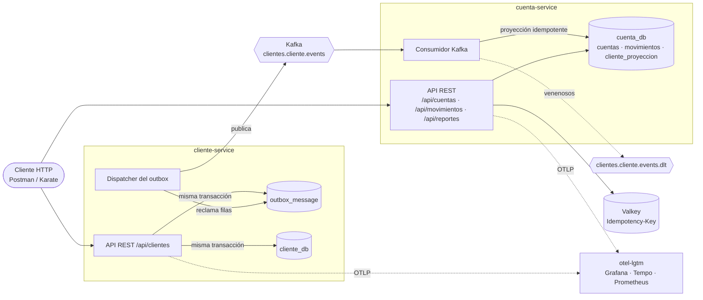
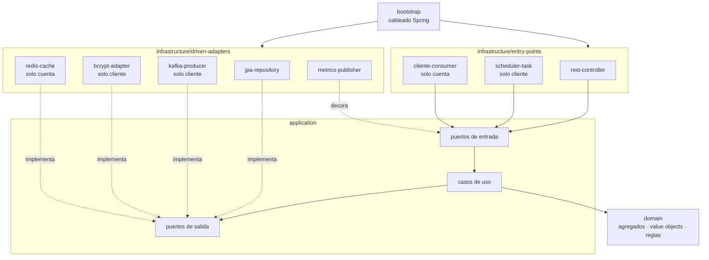
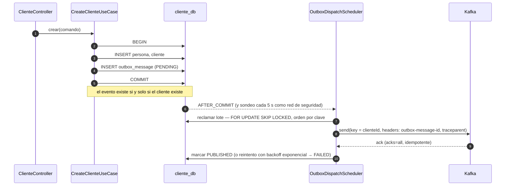
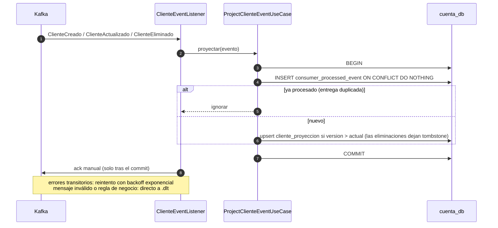
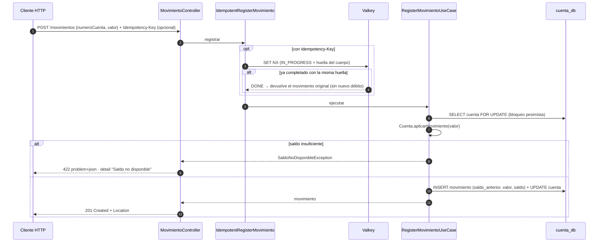
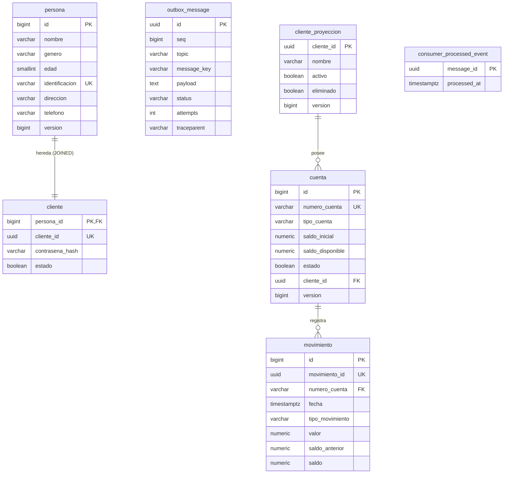

# Arquitectura

Dos microservicios con arquitectura hexagonal (puertos y adaptadores), cada uno dueño de su base de
datos, comunicados de forma asíncrona por Kafka mediante un *transactional outbox*.

| Servicio | Agregados | Puerto API | Puerto actuator | Base de datos |
|----------|-----------|-----------|-----------------|---------------|
| `cliente-service` | Persona, Cliente | 8081 | 9081 | `cliente_db` |
| `cuenta-service` | Cuenta, Movimiento (+ proyección de Cliente) | 8082 | 9082 | `cuenta_db` |

## 1. Contexto y contenedores

**Por qué asíncrono.** `cuenta-service` necesita saber si un cliente existe y está activo para abrirle una
cuenta, y su nombre para el estado de cuenta. En vez de consultarlo por HTTP en cada petición (acoplamiento
temporal: si `cliente-service` cae, nadie abre cuentas), mantiene una **proyección local** alimentada por
eventos. Cada servicio sigue funcionando aunque el otro esté caído; la proyección se pone al día al volver.

## 2. Capas hexagonales

Cada servicio es un build Gradle multi-módulo; las dependencias apuntan siempre hacia el dominio y
ArchUnit lo verifica en cada build.

| Capa | Contiene | No contiene |
|------|----------|-------------|
| `domain` | `Cliente` (hereda de `Persona`), `Cuenta`, `Movimiento`, value objects (`Monto`, `NumeroCuenta`, `Identificacion`…), excepciones de negocio | Ninguna dependencia de framework |
| `application` | Casos de uso, comandos, puertos, contrato del outbox | Anotaciones de Spring, `@Transactional` (la transacción es un puerto: `TransactionPort`) |
| `infrastructure` | JPA, Kafka, Valkey, BCrypt, REST, métricas | Reglas de negocio |
| `bootstrap` | `@Configuration`, `application.yml`, tests de integración, Karate y ArchUnit | Lógica |

Las métricas (`usecase.operation`, `.calls`, `.errors`) se añaden con **decoradores** sobre los puertos de
entrada (cadena de responsabilidad armada en `UseCaseConfig`), así los casos de uso no saben de Micrometer.

## 3. Publicación de eventos: transactional outbox

- **Sin doble escritura:** la fila del outbox se confirma en la misma transacción que el cliente; un fallo de
  Kafka nunca pierde ni inventa eventos.
- **Varias instancias:** el reclamo con `SKIP LOCKED` y un TTL de reclamo permite escalar el dispatcher en
  horizontal sin publicar dos veces el mismo lote; una instancia caída libera sus filas al vencer el TTL.
- **Orden por cliente:** la clave del mensaje es el `clienteId` (misma partición) y un evento no se publica
  mientras uno anterior de la misma clave siga pendiente.

## 4. Consumo idempotente y proyección

Kafka entrega *at-least-once*; la tabla de eventos procesados y la versión del agregado convierten eso en
*effectively-once* y toleran desorden y repeticiones.

## 5. Registro de movimientos (F2, F3)

- El signo del valor define el tipo (`DEPOSITO` / `RETIRO`); el saldo nunca queda negativo (regla del
  dominio y `CHECK` en la base).
- Concurrencia: el bloqueo pesimista serializa los movimientos de una misma cuenta; un test con 10 retiros
  concurrentes de 150 sobre 1000 confirma que solo pasan 6 y el saldo queda en 100.
- Cada movimiento guarda `saldo_anterior` y `saldo`: el historial es auditable y el reporte muestra el
  "Saldo Inicial" de cada fila sin recalcular.
- Si Valkey no responde, un *circuit breaker* abre y la API contesta `503` con `Retry-After` en vez de
  arriesgar un doble débito (*fail-closed*).

## 6. Modelo de datos

`cliente_db` (arriba: `persona`, `cliente`, `outbox_message`) y `cuenta_db` (el resto) son bases distintas;
no hay claves foráneas entre servicios. El esquema completo está en [`BaseDatos.sql`](../BaseDatos.sql),
generado desde los changelogs de Liquibase.

## 7. Rendimiento, escalabilidad y resiliencia

| Factor | Decisión |
|--------|----------|
| Rendimiento | Índices para cada consulta (`ix_movimiento_cuenta_fecha` para el reporte, `ix_cuenta_cliente`); paginación por offset en todos los listados; reporte limitado a 366 días; `open-in-view` desactivado; pool Hikari acotado. |
| Escalabilidad | Servicios sin estado: se escalan en horizontal detrás de un balanceador. El dispatcher del outbox reclama con `SKIP LOCKED`; el topic tiene 3 particiones por `clienteId`, así hasta 3 consumidores reparten carga sin perder el orden por cliente. Base de datos por servicio. |
| Resiliencia | Outbox con reintentos y backoff; consumidor con reintentos, DLT y ack manual; *circuit breaker* sobre Valkey; timeouts explícitos en Kafka (productor), Redis y Hikari; *graceful shutdown*; probes de liveness/readiness separadas (la base caída saca la instancia del balanceador sin reiniciarla). |
| Observabilidad | Trazas OTLP (Micrometer + OpenTelemetry) con `traceparent` propagado por Kafka; métricas Prometheus/OTLP por caso de uso; `traceId` en logs y en cada `problem+json`. |
| Seguridad | Contraseñas con BCrypt, nunca devueltas ni registradas; roles de base separados (DDL para Liquibase, DML para la app); contenedores sin root; actuator en un puerto no publicado. |
